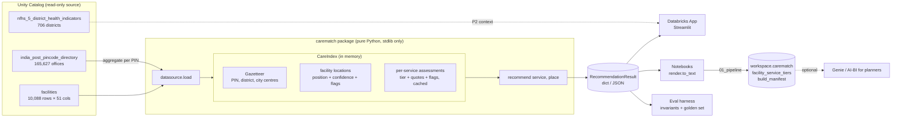

# CareMatch system design (v1 · 2026-11-21)

How the pieces fit together, from the Databricks source tables to the card a health worker reads.
Ranking and evidence rules live in [design.md](design.md) and [evidence_calibration.md](evidence_calibration.md);
this document covers architecture, contracts, runtime, deployment and evaluation.
Reflects the code at commit `36ad9ae` (location resolution + banded ranking).

## 1. Requirements and where each is met

| Challenge requirement | How we meet it | Component | Status |
| --- | --- | --- | --- |
| Input: a service | 9 services with aliases (dialysis, C-section, NICU, trauma, 24x7 emergency, burn, cardiac surgery, MRI, CT) | `services.resolve_service` | done |
| Input: city, district, PIN or coordinates | Gazetteer built from the PIN directory and facility cities; reports precision and ambiguity | `geo.Gazetteer.resolve` | done |
| Best option(s) + explanation | Up to 3 cards, plus a "farther, stronger" option and an honest no-answer state | `recommend.recommend` | done (engine) |
| WHY: facility exists | Location confidence from 3 signals (coordinates, PIN centre, city centre); duplicate listings merged | `geo.facility_location`, `recommend._dedupe` | done; merged-record detection P1 |
| WHY: offers the service | 1–3 verbatim quotes with the column they came from, and an evidence tier | `evidence.assess` | done |
| WHY: best for this location | Nearest distance band with credible evidence, stated in the card | `recommend` (`why_ranked`, `considered`) | done; runner-ups P1 |
| HOW did you decide | Method page in the app, rules docs, calibration table, evaluation numbers | app + docs + `eval/` | pending |
| Runs on Databricks Free Edition | Databricks App (primary) + notebooks (reproduce, backup demo) | `app/`, `notebooks/` | pending |
| Uses the provided dataset | Reads the Unity Catalog source tables directly at startup | `carematch/datasource.py` | pending |
| Non-technical workflow | Pick a service, type a place, read cards, call | `app/` | pending |
| Cite text for any claim, score or ranking | Every card statement maps to a quoted field, a flag, or a stated rule | card fields, `FLAG_TEXT` | done |
| Communicate uncertainty | Tiers, plain-language flags, "ask when calling", disclaimer, abstention | engine + UI | done (engine) |

Out of scope by design: real-time availability, clinical quality, road travel time, patient data, an LLM in the scoring path.

## 2. Architecture



**Decision: one engine, three front ends.** All logic lives in the `carematch` package. The app, the notebooks and the tests
call the same `recommend()`, so a judge who runs the notebook gets exactly what the app shows.

Why this shape:

- **Size.** 10k facilities fit in memory (260 MB measured locally). A query is a linear scan plus sorting: under 10 ms.
  Spark or a SQL warehouse at query time would add seconds of latency and a moving part, and buy nothing.
- **Rules need Python.** Per-claim regex classification, negation windows and three-signal location voting are readable in
  Python and unreadable in SQL.
- **Testable offline.** Stdlib only, so `python -m unittest` runs on a laptop against exported CSVs.
- **No LLM ranker.** The challenge asks HOW we decided. Deterministic rules give the same answer every time, can be shown
  on one page, and cannot invent a citation. If an LLM is used at all, it sits on top of finished outputs (Genie), never inside scoring.

## 3. Components

### 3.1 Loader — `carematch/datasource.py` (new)

`load(source) -> (facility_rows, pincode_rows)`, each a list of `dict[str, str]` with exactly the column names of the
exported CSVs. Sources, tried in order:

| Source | Used by | How |
| --- | --- | --- |
| Unity Catalog via SQL warehouse | App | `databricks-sql-connector` with the app's service principal (`databricks-sdk` `Config()`) |
| Unity Catalog via Spark | Notebooks | `spark.table(...)` / `spark.sql(...)` |
| Snapshot CSVs in `/Volumes/workspace/carematch/exports/` | App fallback | written by `notebooks/00_export_data.py` |
| `data/*.csv` | Local dev, tests | current `CareIndex.from_csv` |

The PIN aggregation SQL is the one in `notebooks/00_export_data.py`; it must stay identical in every path.

**Parity risk.** The engine was calibrated on CSV text. Spark returns `double` for latitude/longitude, `None` for NULL
and real numbers for numeric strings, while CSV gives strings and `''`. The loader must cast every value to the CSV string form
(`None -> ''`, floats with `repr`). A parity test runs five golden queries on both sources and requires identical results.

### 3.2 Location — `carematch/geo.py`

- `Gazetteer.resolve(text)` accepts `"lat, lon"`, a 6-digit PIN, or a city/district name with an optional `", State"`.
  It returns `lat/lon`, `kind` (coordinates / pin / pin_area / city / district), `precision_km`, `notes` and `alternatives`
  (for example Aurangabad in Maharashtra vs Bihar). Unknown input returns `{'error': ...}`.
- `facility_location(row, gaz)` compares the record's coordinates, its PIN centre and its city centre. When two agree and
  one does not, the odd one out is treated as the error. Output: `position`, `basis`, `confidence` (high / medium / low), `flags`.
- Thresholds: PIN spread ≤ 60 km to be a usable reference; coordinates > 50 km from the PIN centre conflict; > 100 km from the city median is an outlier.

### 3.3 Evidence — `carematch/services.py`, `carematch/evidence.py`

Each JSON-array claim in `procedure`, `equipment`, `capability` (and sentences of `description`) is classified on its own as
direct / listed / indirect / negative / mention / related. Tiers per (facility, service): Strong, Moderate, Weak, None, with caps
for facility type, small clinics claiming inpatient services, and contradictions. Only Strong and Moderate are recommended.
Calibration on all 10,088 rows: [evidence_calibration.md](evidence_calibration.md).

### 3.4 Ranker — `carematch/recommend.py`

1. Resolve service and place; return an error for either failure.
2. For every facility with tier ≠ None: compute straight-line distance from its position (the farthest candidate when
   location signals conflict). A Strong facility with low location confidence is treated as Moderate.
3. Find the nearest band (25 / 75 / 150 / 300 km) that contains any Strong or Moderate facility.
4. Inside the band sort by tier, then distance (0.1 km), then evidence count; merge listings with the same name within 2 km; keep 3.
5. If the chosen cards are all Moderate and a Strong facility exists in the next band, add it as `farther_stronger`.
6. Nothing within 300 km: no recommendation; return the nearest credible facility beyond 300 km and up to 3 Weak mentions within 75 km, each labelled.

| Constant | Value | Why |
| --- | --- | --- |
| `BANDS_KM` | 25, 75, 150, 300 | roughly: same town, same district, neighbouring district, a day's travel |
| `MAX_RESULTS` | 3 | challenge asks for the best few; fewer is allowed |
| `DEDUP_KM` | 2.0 | same name within 2 km is one facility |

Determinism: Python's sort is stable and the input order is fixed, so equal keys always come out in the same order.

### 3.5 Explanation

Template-only. Every sentence on a card comes from one of three places: a quoted claim (`evidence[].quote` + `field`),
a flag translated by `FLAG_TEXT`, or the stated ranking rule (`why_ranked`, `method`). Nothing is paraphrased by a model,
so nothing can drift from the source text.

### 3.6 App — `app/` (new)

Streamlit, deployed as a Databricks App whose source path is the **repo root** (so `carematch/` is importable without copying):

```text
app.yaml            # command: ["streamlit", "run", "app/app.py"]; resource: SQL warehouse
requirements.txt    # streamlit, databricks-sql-connector, databricks-sdk
app/app.py          # UI only; no ranking logic
app/components.py   # card, evidence drawer, no-answer state, method page
```

Startup: `st.cache_resource` builds `CareIndex` and assesses all 9 services **before the first search** (25 s on a laptop;
budget about 60 s on app compute). The cache is shared by all visitors, so only the first visit after a deploy waits; the team
opens the app once right after each deploy. A background warm-up thread was tried and rejected: the CPU-bound thread starved
Streamlit's own thread of the GIL, and a first search took 16 s instead of 3 s.

Screen, top to bottom (phone-first):

1. **Inputs**: service dropdown (9 labels); place text box with examples ("Patna", "800001", "25.61, 85.14").
2. **Where we searched from**: origin label, precision, notes; one button per alternative ("Aurangabad, Bihar").
3. **Cards (0–3)**: rank, name, distance + basis, tier badge, 1–3 quotes with their column, uncertainties in plain words,
   phone as a `tel:` link, "ask when you call" questions, source links. Expander: all evidence for this facility.
4. **Farther, stronger option** when present, visibly separated.
5. **No-answer state**: "No facility with credible evidence within 300 km", then the nearest beyond and weak mentions, labelled unverified.
6. **How we decided** (expander): method sentence, counts per band (Strong / Moderate / Weak considered), runner-ups (P1).
7. **Map**: origin + results (`st.map`), P1.
8. **Footer**: disclaimer. A separate **Method** page holds tier rules, bands, calibration examples, evaluation results and limits.

An engine error and an empty result are different screens. A data-load failure shows an error page, never "no hospitals found".

### 3.7 Notebooks — `notebooks/`

| Notebook | Purpose |
| --- | --- |
| `00_export_data.py` (exists) | snapshot source tables to a Volume for local dev and app fallback |
| `01_pipeline_and_checks.py` | load from UC → build `CareIndex` → run invariants → write `facility_service_tiers` and `build_manifest` |
| `02_demo.py` | widgets (service, place) → `render.to_text`; backup demo if the app is down |
| `03_evaluation.py` | golden set, metrics, sensitivity analysis; numbers copied into README and the Method page |

### 3.8 Quality gate — `carematch/review.py` (new)

`review(result, index) -> {'passed': bool, 'checks': [{'name', 'passed', 'detail'}]}` runs the invariants of section 8
on **every** result before it is shown, and `recommend()` attaches the outcome as `result['review']`. The app shows
"Quality checks: 7/7 passed" and lists any failure in plain words instead of hiding it. Deterministic, no LLM.
(Pattern borrowed from the John Data Lab reviewer; the rules are ours.)

### 3.9 Evaluation harness — `eval/` (new)

`eval/queries.csv` (golden set), `scripts/run_eval.py`, `tests/test_invariants.py`. Same shape as a regression test:
run every case → per-case rows → summary metrics → fail if a metric falls below its threshold. See section 8.

## 4. Contracts

### 4.1 Source rows → engine

`dict[str, str]` keyed by the 51 source column names. PIN rows: `pincode, district, statename, n_offices, n_geocoded, lat, lon,
lat_min, lat_max, lon_min, lon_max` (one row per PIN × district × state).

### 4.2 `recommend()` → front ends (RecommendationResult)

Either `{'error': str}` or:

| Field | Type | Meaning |
| --- | --- | --- |
| `service`, `service_label` | str | canonical key and display label |
| `origin` | object | resolved place: `label, kind, lat, lon, precision_km, state, district, notes[], alternatives[]` |
| `band_km` | int \| null | band the results came from; null when nothing within 300 km |
| `results` | Card[] (0–3) | recommendations, with `rank` and `why_ranked` |
| `farther_stronger` | Card \| null | Strong option in the next band when results are all Moderate |
| `nearest_beyond` | Card \| null | only when `results` is empty |
| `weak_nearby` | Card[] | only when `results` is empty; labelled unverified |
| `considered.by_band` | {km: {strong, moderate, weak}} | how many were weighed at each distance |
| `considered.recommendable_without_location` | int | credible facilities skipped because no position |
| `method`, `disclaimer` | str | shown verbatim |

Card: `facility_id, name, type, operator, address, city, state, district, pin, phone, website, beds, doctors,
distance_km, distance_basis, location_confidence, tier, tier_reasons[], evidence[{evidence_id, field, quote, kind}],
all_evidence_count, n_claims, flags[], uncertainties[], source_urls[], ask_when_calling[], merged_ids[]?, note?, rank?, why_ranked?`.

Rules: changes are additive only; the UI must tolerate missing optional keys. Add `contract_version: "1"` at the top level (P1).
Unknown distance is `null`, never `0`.

### 4.3 Derived tables (`workspace.carematch`)

| Table | Grain | Columns | Used by |
| --- | --- | --- | --- |
| `facility_service_tiers` | facility × service (tier ≠ None) | facility_id, name, service, tier, reasons, flags, n_claims, top_quote, top_field, lat, lon, location_confidence, city, district, state | eval, Genie/dashboard (planner view, P2) |
| `build_manifest` | one row per build | built_at, git_sha, source row counts, tier counts per service, invariants passed/failed | README, judges |

## 5. Query path and latency

| Step | Work | Measured (laptop) |
| --- | --- | --- |
| App start | load source tables, build `CareIndex` | 0.6 s from CSV; UC fetch adds ~10–30 s (to measure) |
| Warm-up | assess 10,088 rows × 9 services, before the first search | 25 s, once per app start |
| Query | resolve place → scan → band → sort → dedupe → cards | < 10 ms engine; < 0.7 s end to end in the app (AppTest) |

Memory: 260 MB peak.

## 6. Runtime and deployment on Free Edition

**Platform limits** ([Free Edition limitations](https://docs.databricks.com/aws/en/getting-started/free-edition-limitations)):
serverless compute only; one SQL warehouse, 2X-Small; a small number of Databricks Apps per account (docs say up to 3,
some users report 1); **an app stops automatically 24 hours after it was last started or deployed**. App compute size is not
documented (one community report: 2 vCPU / 6 GB). Our footprint fits comfortably.

**Data access from the app.** The app runs as its own service principal. It needs:
1. the SQL warehouse attached as an app resource (CAN_USE);
2. `USE CATALOG` / `USE SCHEMA` / `SELECT` on the source tables. If the challenge catalog does not allow grants to our
   service principal, fall back to the Volume snapshot (`READ VOLUME` on `workspace.carematch.exports`).

This is the riskiest unknown in the whole build, so it is tested first with a hello-world app that reads one row (plan gate G1).

**Deploy steps** (user, in the Databricks UI): Compute → Apps → Create app (custom) → attach SQL warehouse resource → source path =
the Git folder root → Deploy. Grant the app's service principal access to the tables (Catalog Explorer → Permissions).
**Redeploy on the morning of the deadline** so the 24-hour timer cannot stop the app during judging.

## 7. Failure modes

| Situation | Behaviour |
| --- | --- |
| Unknown service text | error listing the 9 supported services |
| Place not found | error with input hints (PIN, district, "lat, lon") |
| Ambiguous place name | best match by facility count; note + one-click alternatives |
| PIN with an unreliable centre | centre of nearby PINs sharing 4 digits, labelled approximate |
| Facility coordinates contradict PIN and city | use the PIN centre, flag `coords_wrong_used_pin` |
| All three location signals disagree | farthest candidate distance, flag `location_conflict`, Strong → Moderate |
| No position at all | excluded from ranking, counted in `recommendable_without_location` |
| Nothing credible within 300 km | no recommendation; nearest beyond + weak mentions, labelled |
| Data load fails at startup | error page with the cause; never an empty result |
| First visit after a deploy | spinner explaining the one-time load (about a minute) |

## 8. Evaluation design

**Invariants** (automatic, `tests/test_invariants.py` + notebook 01, run on every build):

1. Same input → identical output (run twice, compare JSON).
2. ≤ 3 results; every result tier ∈ {strong, moderate}.
3. No two results with the same normalized name.
4. Every card has ≥ 1 quote, and **every quote is a verbatim substring of the named source field of that facility's row** (citation fidelity; must be 100%).
5. `distance_km` is null or > 0; it is never 0 for an unknown position.
6. Results are ordered by (tier, distance) inside the band, and all lie within `band_km`.
7. No-answer results carry no `rank`.

**Golden set** (`eval/queries.csv`, about 36 queries): 9 services × 4 place types (metro, tier-2 city, rural PIN, northeast or remote),
including cases where the honest answer is "nothing credible nearby". For the top-1 card of each, a human records:
does the quote support the service (yes / partly / no); is it one real facility (yes / merged / duplicate).

| Metric | Target |
| --- | --- |
| Citation fidelity (auto) | 100% |
| Top-1 quote supports the service (human) | ≥ 85% |
| Duplicate listing in top 3 | 0 |
| Share of results with computable distance | report |
| Correct abstention on "nothing nearby" cases | report |
| Query latency p95 (warm) | < 100 ms |

**Sensitivity.** Re-run the golden set with bands (20/60/120/250) and (30/90/180/350), and with the Strong rule tightened
(≥ 3 claims). Report the overlap of top-3 sets. If the top-3 order is unstable but the set is stable, the UI says so: tiers, not exact ranks.

## 9. Gaps, in priority order

| P | Gap | Owner area |
| --- | --- | --- |
| P0 | `datasource.py` + parity test; app skeleton deployed with UC access | platform |
| P0 | `review.py` quality gate on every result + invariants test, including citation fidelity | engine |
| P1 | runner-ups: next 3 candidates in or near the band with the reason each lost ("why not this one") | engine |
| P1 | merged-record flag: a claim that names another city or another facility (e.g. "Smile Art Dental Clinic … located in Patna" in a Muzaffarpur record) | engine |
| P1 | `contract_version`; map; Method page with evaluation numbers | engine / app |
| P2 | NFHS district context line on the result header (e.g. district C-section rate); planner view via Genie on `facility_service_tiers` | app |

## 10. Decision log

| # | Decision | Alternative rejected | Reason |
| --- | --- | --- | --- |
| D1 | Rules, not a trained model | ML ranker | no labels; must explain HOW; rules are auditable |
| D2 | Distance bands, then tier | single weighted score | a number hides the trade-off; bands explain in one sentence |
| D3 | One in-memory Python engine | SQL / Spark at query time | 10k rows; <10 ms; same code everywhere |
| D4 | Databricks App primary, notebook backup | notebook + dashboard only | non-technical users; notebook keeps reproducibility |
| D5 | Straight-line km, labelled | road routing API | no external services; honest label instead |
| D6 | Template explanations | LLM-written text | cannot invent citations |
| D7 | Recommend Strong/Moderate only; show Weak only when nothing else, labelled | pad to 3 | a confident wrong answer costs hours |
